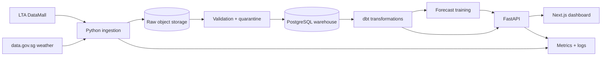

# Architecture

## Target design



## Design decisions

- **Adapters isolate providers.** External payload changes should not leak into
  domain models or UI code.
- **Raw data is immutable.** Reprocessing and incident investigation require
  the original source payload and ingestion timestamp.
- **Quality is a first-class output.** Freshness, completeness, uniqueness, and
  validity are visible to users and monitored like application health.
- **Forecasting starts with a baseline.** A complex model is shipped only if it
  beats a transparent naive prediction on held-out time periods.
- **Credentials stay server-side.** LTA keys are read from environment or a
  cloud secret manager and never sent to the browser.

## Repository layout

```text
apps/web/          Next.js decision dashboard
services/api/      FastAPI source and domain API
docs/              product, data, architecture, and delivery evidence
.github/workflows/ automated quality gates
```

`pipelines/`, `warehouse/`, and `infra/` will be introduced only when their
milestones begin so the repository does not contain empty architecture theatre.

