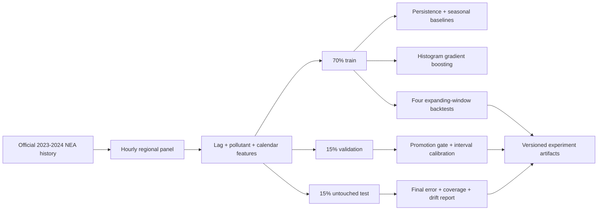

# Forecasting pipeline

FluxSG Milestone 4 evaluates a one-hour-ahead regional 24-hour PSI forecast for
Singapore. The pipeline is designed to make failure visible: chronological
splits replace random shuffling, simple baselines remain first-class competitors,
and a candidate is promoted only when it passes a fixed validation and
backtesting rule.

## Prediction contract

| Field | Definition |
|---|---|
| Target | Regional 24-hour PSI at the next hourly observation |
| Regions | Central, east, north, south, and west |
| Candidate | Histogram gradient boosting regression |
| Baselines | Current-value persistence and the observation 24 hours earlier |
| Interval | Symmetric 90% interval calibrated from validation residuals |
| Safety boundary | Experimental decision support; never official health advice |

The features available at observation time include current pollutant readings,
PSI lags from 1 to 168 hours, rolling PSI summaries, hour/day cycles, and region
indicators. The target is shifted forward after each region is reindexed to an
hourly grid, preventing a missing interval from silently becoming a false
one-hour example.

## Evaluation design



All five regions share the same time boundaries. No observation from validation
or test is available while fitting the evaluation model. After scoring, a
separate serving artifact is fitted on all labelled history; its metrics remain
the earlier out-of-sample measurements rather than in-sample scores.

## Promotion rule

The candidate must:

1. beat both the persistence and 24-hour seasonal baselines on validation MAE;
2. beat persistence in a majority of four expanding-window backtests.

The untouched test partition estimates final generalisation but is not used to
choose the winner. A failed rule still produces a report, but the model artifact
is labelled rejected.

## Reproduce the experiment

Docker Desktop is the only local prerequisite:

```bash
make forecast-data
make forecast
make forecast-drift
make forecast-test
```

`forecast-data` downloads the 2023 and 2024 historical PSI CSVs through the
official data.gov.sg dataset-download API. Raw downloads and fitted binaries are
ignored by Git. Every run records source SHA-256 fingerprints, package versions,
the random seed, time boundaries, metrics, test predictions, drift profiles, and
the Git commit.

Generated artifacts are written to `ml/artifacts/latest/`:

```text
drift_report.json       held-out distribution comparison
latest_forecast.csv     one forecast per Singapore region
metrics.json            evaluation, backtests, and provenance
model.joblib            fitted serving bundle
test_predictions.csv    row-level out-of-sample evidence
training_reference.json drift-monitoring reference
```

## Data provenance

- Provider: National Environment Agency through data.gov.sg
- Collection: Historical Pollutant Standards Index (PSI), collection `2215`
- Training datasets: 2023 `d_10501b71361f97dbbbab82095406c9c5` and 2024
  `d_9213cd2e4631f7148ab5932a10df9958`
- Licence: Singapore Open Data Licence
- Known source limitation: the archive warns that records can be missing and
  have not received the quality control used for official climate records

See [`MODEL_CARD.md`](MODEL_CARD.md) for measured results, limitations, and the
release decision. The complete reference result is versioned as
[`ml/reports/reference_metrics.json`](../ml/reports/reference_metrics.json).

## Production publication

`fluxsg-forecast fetch-live` obtains nine days of hourly regional PSI features.
`fluxsg-forecast publish` loads the fitted model, measures live drift, evaluates
freshness and release checks, and writes the public JSON contract. A withheld
contract is a successful safety outcome rather than a pipeline failure.

Run the same path locally with `make forecast-live`. The hourly production
workflow and all guardrails are documented in [`PRODUCTION.md`](PRODUCTION.md).
