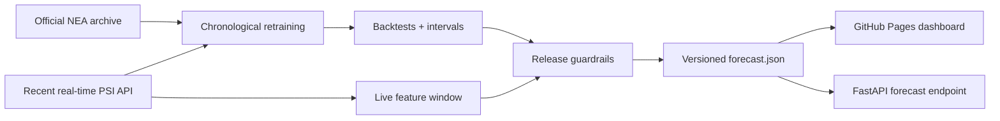

# Production delivery

Milestone 5 turns the offline PSI experiment into a guarded delivery system. It
does not assume that a model which passed a historical benchmark is safe to
publish today.

## Hourly release flow



`.github/workflows/pages.yml` runs on every main-branch push and hourly. It
downloads the official 2023–2024 archive, requests nine days of recent hourly
readings, retrains the deterministic candidate, evaluates it, and publishes a
new manifest only when the full build succeeds. GitHub Pages retains the last
successful deployment if any upstream or build step fails.

The public contract is available at:

```text
GET https://fluxsg-api.vercel.app/api/v1/forecast/psi
GET https://hninphyuphyuaye.github.io/FluxSG/data/forecast.json
```

## Release guardrails

Every manifest carries a boolean decision and the evidence used to make it.
Operational display requires all of the following:

- the source observation is no more than three hours old;
- all five Singapore regions are present;
- the fitted model includes observations no more than 72 hours old;
- the locked offline promotion rule passed;
- the candidate beats persistence on the held-out production evaluation;
- live feature drift is below the alert threshold;
- held-out interval coverage is at least 85%.

A failed check produces `status: withheld`. Predictions remain in the evidence
artifact for debugging, but the citizen dashboard hides the values and shows
the failed guardrail. Both the API and browser independently re-check expiry so
a stale previously published artifact cannot remain labelled available.

## Infrastructure and security

`infra/terraform` manages the `forecast-production` GitHub environment, public
deployment variables, and the manifest URL configured on the existing Vercel
API project. Secrets are intentionally excluded from Terraform state.

The CI system includes:

- API, dashboard, warehouse, forecasting, and Terraform validation;
- weekly and push-triggered CodeQL for Python and JavaScript/TypeScript;
- Python and production JavaScript dependency audits;
- twice-hourly checks of API health, the forecast contract, and the dashboard;
- a live joined-commute smoke check that validates score bounds, source region,
  and the selected bus-stop contract;
- 30-day retention of every forecast manifest, metrics report, and drift report.

## Operations

Prometheus evaluates three service objectives and Grafana provisions the
`FluxSG production operations` dashboard automatically:

| Signal | Objective |
|---|---:|
| API availability | at least 99.5% over 30 days |
| API p95 latency | below 750 ms over 15 minutes |
| ingestion freshness | newest successful run less than 30 minutes old |

Open Grafana locally at <http://localhost:3001>. Prometheus remains available
at <http://localhost:9090> and Jaeger at <http://localhost:16686>.

## Recovery and performance evidence

```bash
make backup
make restore-drill
make load-test
```

The restore drill creates an isolated `fluxsg_restore_drill` database, validates
the restored schema, and removes only that drill database on exit. The bounded
load test uses 500 requests at concurrency 25 and fails unless success is at
least 99.5% and p95 latency remains below 750 ms.

See [`COST_REPORT.md`](COST_REPORT.md), [`OBSERVABILITY.md`](OBSERVABILITY.md),
and [`RUNBOOK.md`](RUNBOOK.md) for the financial and operational handoff.
