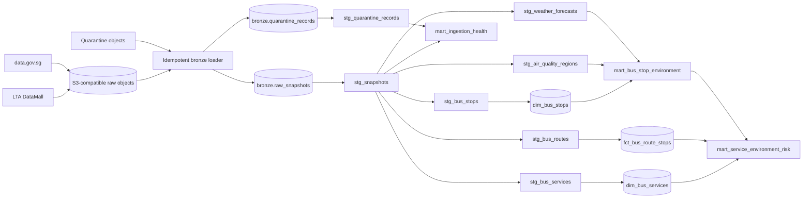

# Analytics warehouse

FluxSG's Milestone 3 warehouse turns immutable Singapore transport, weather,
and air-quality snapshots into tested datasets that analysts can use without
understanding each provider's nested payload. It preserves the original JSON,
normalises it once, and publishes contracted dimensional and analytical models.

## Lineage



## Layer contracts

| Layer | Purpose | Key guarantees |
|---|---|---|
| Bronze | Lossless history from object storage | Original payload retained as JSONB, source key and checksum provenance, idempotent load, quarantine kept separately |
| Silver | Provider-independent records | Typed bus stops, services, route sequences, regional PSI/PM2.5, forecasts, and snapshot quality fields |
| Gold core | Stable analytics grain | One row per stop, service-direction, or route stop; enforced dbt contracts and referential integrity |
| Gold analytics | Decision-ready views | Nearest environmental reading per stop, route-level exposure, and ingestion health |

The loader uses object keys and content checksums as stable identities, so
rerunning it appends genuinely new snapshots but does not duplicate data already
loaded. A deterministic fixture set makes CI independent of LTA credentials and
upstream availability.

## Quality gates

The warehouse gates execute 13 models, 79 data tests, and a separate source
freshness check. Together they cover:

- source freshness and required-field completeness;
- primary-key uniqueness and non-null constraints;
- service/stop relationships across the route fact table;
- accepted values and numeric domains for PSI, PM2.5, direction, and distance;
- coordinates inside Singapore's expected geographic bounds;
- unique positive route sequences and non-decreasing cumulative distance;
- reconciliation of received, valid, and rejected snapshot counts.

Validation on 13 October 2026 completed with **92 passes, 0 warnings, and 0
errors** across models and tests. The configured live-source freshness check
passed. The
same pipeline also passed from an empty temporary database using only fixtures.

## Live-data evidence

The validated live build produced:

| Model | Rows |
|---|---:|
| `dim_bus_stops` | 5,209 |
| `dim_bus_services` | 800 |
| `fct_bus_route_stops` | 26,833 |
| `mart_bus_stop_environment` | 5,209 |
| `mart_service_environment_risk` | 797 |

These counts describe the source snapshots loaded for this validation run; LTA
may add, remove, or revise transport records later.

## Three reproducible business questions

### 1. Which services had the greatest haze exposure?

Run [`q1_services_most_exposed_to_haze.sql`](../warehouse/analyses/q1_services_most_exposed_to_haze.sql).
At approximately 3:00 PM SGT on 13 October 2026, service `143M` direction 1
ranked first in the captured snapshot: all 27 mapped stops were in the west
region, where the snapshot reported PSI 172 and one-hour PM2.5 of 119. Services
`154A`, `160A`, `172`, `173A`, `179`, `179A`, `179B`, and `181` also appeared
among the highest-exposure routes.

### 2. Which stops had combined haze and weather risk?

Run [`q2_stops_with_combined_weather_haze_risk.sql`](../warehouse/analyses/q2_stops_with_combined_weather_haze_risk.sql).
The result links citizen-facing stop names to their nearest official regional
air reading and two-hour forecast. Example flagged stops included `20031` (The
Infiniti) and `20039` (Opp The Infiniti), paired with west-region haze readings
and nearby Clementi/Jurong East shower forecasts.

### 3. Can analysts trust the pipeline before using its results?

Run [`q3_pipeline_quality_and_freshness.sql`](../warehouse/analyses/q3_pipeline_quality_and_freshness.sql).
All three source datasets in the validation run reported 100% completeness,
zero rejected records, and healthy status. This question is intentionally part
of the analytics layer: operational provenance should be visible alongside the
business result.

The findings above are historical snapshot evidence, not current public-health
advice. The application always displays source timestamps and links to official
guidance.

## Reproduce it

With Docker Desktop running and `.env` configured, build from the real snapshots:

```bash
docker compose up -d postgres object-store worker
make warehouse
```

For a deterministic build that needs no LTA key or network source:

```bash
docker compose up -d postgres object-store
make warehouse-fixtures
```

Generate and browse the searchable model catalogue and interactive lineage:

```bash
make warehouse-docs
```

Then open <http://localhost:8080>. Generated dbt artifacts remain local and are
excluded from Git.

## Repository map

```text
warehouse/
├── analyses/       version-controlled answers to the three questions
├── fixtures/       deterministic raw and quarantine records for CI
├── macros/         schema naming behaviour
├── models/
│   ├── staging/    silver normalisation views
│   └── marts/      contracted core tables and analytical views
├── tests/          cross-row and Singapore-domain assertions
└── tools/          idempotent object-store-to-PostgreSQL loader
```
